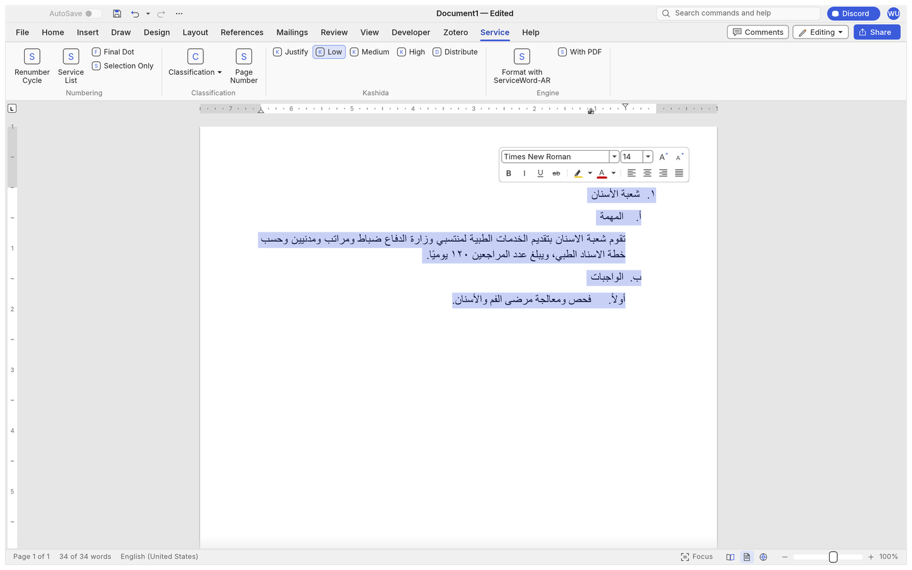
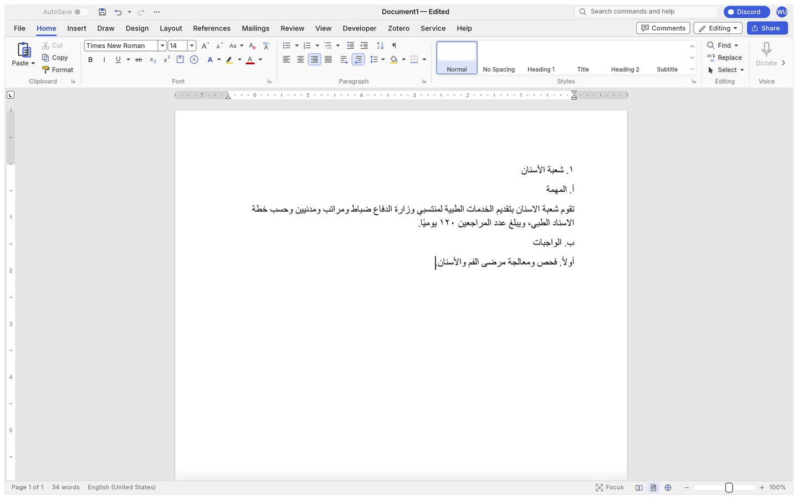
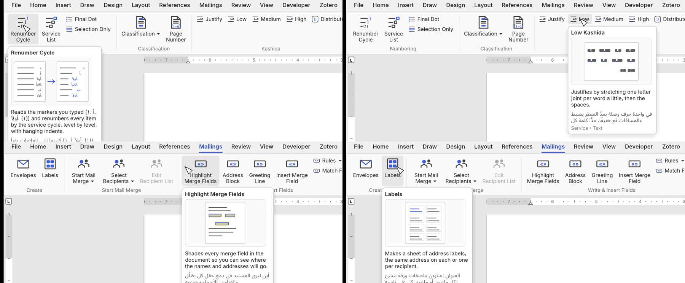
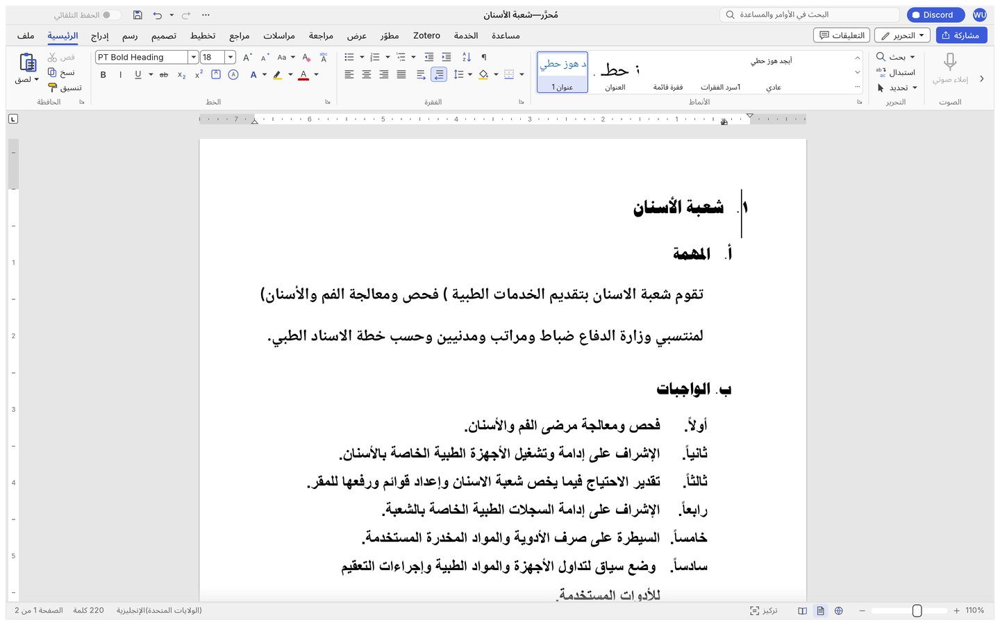

<h1 align="center">WordCraft AR</h1>

<p align="center">
  <b>Arabic typography and military "service writing" tools, built into WordCraft — the open-source, pure-Rust word processor.</b>
</p>

<p align="center">
  <a href="README.ar.md"><b>🇮🇶 اقرأ هذا بالعربية</b></a>
</p>

<p align="center">
  
  
  
  
</p>

> [!IMPORTANT]
> **This is a fork.** WordCraft AR builds on [WordCraft](https://github.com/storytold/wordcraft) by the
> ArtCraft team and the WordCraft contributors — a clean-room reimplementation of Microsoft Word in
> Rust. Everything that makes it a word processor (the engine, the layout, the .docx reader and
> writer, the ribbon, track changes, references, mail merge…) is their work, and it stays under their
> licence and credits. The upstream README is kept intact at
> [`docs/README-upstream.md`](docs/README-upstream.md). This fork adds what Arabic writers — and in
> particular Iraqi military and government clerks — need every day, and nothing is pushed back to the
> upstream repository without going through its own process.

<br>

<p align="center">
  
  <br><sub><b>The Service tab</b> (كتابات الخدمة): the numbering cycle, classification stamp, Arabic-Indic page numbers, kashida justification, and the hand-off to the ServiceWord-AR engine.</sub>
</p>

<p align="center">
  <a href="#what-the-fork-adds">What the fork adds</a> ·
  <a href="#install">Install</a> ·
  <a href="#build-from-source">Build from source</a> ·
  <a href="#the-service-tab">The Service tab</a> ·
  <a href="#for-agents-and-scripts">For agents and scripts</a> ·
  <a href="#keeping-up-with-upstream">Keeping up with upstream</a> ·
  <a href="#roadmap">Roadmap</a> ·
  <a href="#license-and-credits">License and credits</a>
</p>

## What the fork adds

| Area | What you get |
|---|---|
| **Arabic numbering** | Abjad letters (أ، ب، جـ، د، هـ…), Arabic-Indic digits (١، ٢، ٣) and ordinal words (أولاً، ثانياً… up to thirtieth) as real Word list formats, saved as standard `.docx` numbering so Microsoft Word opens them unchanged. The Numbering gallery shows them with live previews. |
| **Service-writing cycle** | One click renumbers a whole document (or a selection) by the nine-level Iraqi service-writing cycle — `١.` → `أ.` → `أولاً.` → `(١)` → … — reading the markers you typed by hand or the Word lists already in the file, with hanging indents per level. |
| **Kashida justification** | Low, Medium and High kashida and Distribute as paragraph alignments, drawn from the document's own font (one joint per word, before the spaces widen), read and written as Word's `lowKashida` / `mediumKashida` / `highKashida` / `distribute`. |
| **Classification & page numbers** | «محدود», «سري»… stamped in the header and footer, and `( ١ - ٥ )` page numbers in Arabic-Indic digits as `PAGE \* HindiArabic` fields. |
| **Arabic defaults** | A new blank document is right-to-left in Times New Roman 14 pt with Arabic as its complex-script language; digits display in Arabic-Indic form next to Arabic text (Word's *Numeral: Context*). Both are options, not hard-wiring. |
| **Arabic interface** | A complete Arabic translation of the interface (2 600+ strings), a bundled Arabic UI font (Noto Sans Arabic), and correct right-to-left ordering of labels that mix Arabic with numbers or Latin names. The interface follows the system language; switch it any time in *File › Options*. |
| **Visual help** | Every button of the Service and Mailings tabs shows, on hover, a drawn thumbnail of what it does and a one-sentence explanation — in the interface language, and in Arabic as well when the interface is another language. |
| **ServiceWord-AR engine** | The Python engine that measures the real fonts, equalises markers and writes the kashida into the text itself ships beside the app (`servicewordar/`) with its own embedded Python, and is one button away: *Format with ServiceWord-AR*, with or without the stamped print PDF. |
| **Built for old machines** | Whole-program optimised, stripped release builds; an *Old computer mode* that drops every animation; no runtime, no Python and no internet required on the target machine. |
| **Separate identity** | WordCraft AR installs side by side with WordCraft: its own window title, app id (`ai.storyteller.wordcraft-ar`), settings folder (`%APPDATA%\WordCraft-AR`) and installer upgrade code. |

<table>
<tr>
<td width="50%" valign="top"><p align="center"><sub><b>A new document</b> is Arabic from the first keystroke: right-to-left, Times New Roman 14 pt, Arabic-Indic digits — with the interface in whatever language you prefer.</sub></p></td>
<td width="50%" valign="top"><p align="center"><sub><b>Visual help.</b> Hover any Service or Mailings button for a thumbnail, an explanation, and its Arabic translation.</sub></p></td>
</tr>
<tr>
<td colspan="2"><p align="center"><sub><b>The Arabic interface</b>, one option away. Labels that mix Arabic with numbers read correctly («الصفحة 1 من 2», «220 كلمة»).</sub></p></td>
</tr>
</table>

Everything upstream WordCraft does is still here: the ribbon, styles, tables, track changes,
comments, references, mail merge, PDF export, the command-line tool and the MCP server. See the
[upstream README](docs/README-upstream.md) for the full tour.

## Install

### Windows (the common case)

Download `WordCraft-AR-<version>-windows-x64.msi` from the
[Releases](../../releases) page and run it. The installer is self-contained (no Visual C++
redistributable, no internet needed), so it can be carried on a USB stick to an offline machine. It
installs beside WordCraft if that is present, adds a Start-menu entry and a desktop shortcut, and
puts the ServiceWord-AR engine next to the program.

Nothing else is needed: the ServiceWord-AR engine ships with its own embedded Python and
libraries (`servicewordar\python`), so *Format with ServiceWord-AR* works on a machine that has
never seen Python or the internet. For old machines, *File › Options › General › Old computer
mode* switches every animation off and starts straight on a blank document.

### macOS and Linux

Build from source (below); the upstream packaging scripts in `packaging/` work unchanged apart
from the product name.

## Build from source

```
git clone https://github.com/<you>/wordcraft-ar.git
cd wordcraft-ar
cargo build --release -p wordcraft -p wordcraft-cli
```

Needs a stable Rust toolchain (1.95 or newer) and, on Windows, the MSVC Build Tools (rustup's
installer offers them). On Windows, `build-windows.bat` does the above and collects the
program, the CLI and the engine into `dist\`. The first build takes 10–25 minutes; later builds are
incremental.

The tests that pin the Arabic behaviour run with
`cargo test -p wordcraft-doc -p wordcraft-layout -p wordcraft-engine -p wordcraft-ui-egui`.

## The Service tab

| Button | Command | What it does |
|---|---|---|
| Renumber Cycle | `service.renumber` | Reads the typed or Word-list markers and renumbers every item by the cycle, level by level, with hanging indents. *Selection Only* limits it to the selected paragraphs. |
| Service List | `service.applyList` | Turns the typed markers into a real Word multilevel list that keeps numbering itself. |
| Final Dot | `service.finalDot` | Ends every item with a full stop. |
| Classification | `service.classification` | Stamps the classification word in the header and footer (`محدود` by default). |
| Page Number | `service.pageNumbers` | Writes `( page - total )` in Arabic-Indic digits at the bottom of every page. |
| Justify · Low · Medium · High · Distribute | `service.kashida` | Kashida justification levels and Distribute for the current paragraphs. |
| Format with ServiceWord-AR · With PDF | `service.external` | Hands the document to the Python engine and opens the result; optionally also the stamped print PDF. |

The cycle, the kashida and the numbering formats are described in detail (in Arabic) in
[`AR-FORK.md`](AR-FORK.md).

## For agents and scripts

Every button is a command, so the whole Service tab is scriptable from the command line and over
MCP exactly like upstream WordCraft:

```
wordcraft-cli run --file letter.docx \
  --cmd service.renumber \
  --cmd 'service.classification={"value":"محدود"}' \
  --cmd 'service.kashida={"value":"low"}' \
  --save letter-formatted.docx
wordcraft-cli convert letter-formatted.docx letter-formatted.pdf
```

`wordcraft-cli commands | grep service.` lists them with their parameters.

## Keeping up with upstream

Upstream WordCraft moves fast, and this fork is meant to follow it rather than drift. The branch
`ar-main` carries the fork; `upstream` is the original repository's remote.

```
scripts/sync-upstream.sh      # fetch upstream/main, merge it into ar-main, run the Arabic tests
```

Conflicts in the files this fork owns (`scripts/ar-owned.txt`) are resolved in the fork's favour
and reviewed by hand; everything else takes upstream's side.

## Roadmap

- A right-to-left ribbon layout (the interface is translated, but egui lays widgets out left to right).
- Moving the ServiceWord-AR measurements (ink-equalised markers, derived lam-alef) from Python into the Rust layout.
- Arabic spelling.
- Review of the Arabic catalog by more native users — every string is one line in `crates/ui-egui/src/i18n/ar.tsv`.

## License and credits

WordCraft AR is licensed, like WordCraft, under the **MIT License or the Apache License 2.0, at
your option** ([LICENSE-MIT](LICENSE-MIT), [LICENSE-APACHE](LICENSE-APACHE)).

- **[WordCraft](https://github.com/storytold/wordcraft)** — © the ArtCraft Team and the WordCraft
  contributors. The word processor this fork is built on; thank you for making it open.
  The ArtCraft name and logos are their trademarks and are not used by this fork.
- **WordCraft AR** — the Arabic typography, the Service tab, the Arabic interface and the visual
  help, by Younis (Iraq) with Claude (Anthropic) as the coding partner.
- **ServiceWord-AR** — the Python formatting engine for Iraqi service writing, by the same author.
- Fonts: Noto Sans Arabic and Noto Naskh Arabic (Google, SIL Open Font License 1.1) join the
  upstream fonts; every bundled file is listed with its licence in [`ATTRIBUTION.md`](ATTRIBUTION.md).

If this fork is useful to you, star the [upstream project](https://github.com/storytold/wordcraft)
too — none of this would exist without it.
